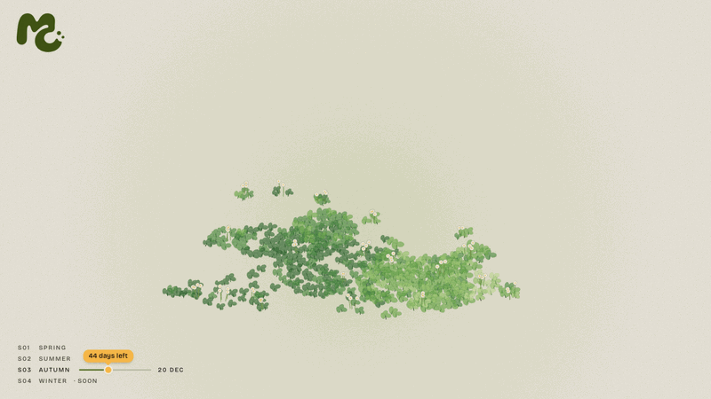

# Moss & Crumb

Interaction design concept for a seasonal cookie shop's homepage. Autumn 2026, four flavours.



## Overview

A seasonal menu changes a shop's window every few months. This concept does the same for a website: the homepage is rebuilt around each season's limited cookies.

The page is one scene, a cookie floating over a paper-cut clover garden. You learn about the cookies by touching them, not by reading a product list.

## Interactions

| Do this | You get |
|---|---|
| Tap the cookie | It crumbles, and a plant for that flavour grows where the crumbs land |
| Pick a cookie from the tray | The new cookie drops in and the sticky note changes to match |
| Leave it alone | The cookie hops every few seconds, and the untried cookies bob in the tray |
| Try all four flavours | A Taster Box rises at the edge of the garden, and the note switches to the box |
| Click the box or its tag | The note answers "Saved a spot" |
| Look at the bottom left | The season timeline, with a progress line and the days left |

## Design notes

- **Sticky note, not a product card.** Each flavour has a handwritten note. The name takes the flavour's colour and the rest stays brown, so the order of reading is clear: name, description, taste, Pre-order.
- **Taste as dots.** Taste notes are rated in dots, like the intensity bars on a coffee capsule box. Each flavour has its own words (Roasty, Grassy, Nutty, Zesty), because one shared scale made the four cookies sound alike.
- **The deadline appears once.** It sits on the season timeline at the bottom left. Repeating it on the note and the flag made the page busy.
- **Hints, not labels.** An early "tap me" text was too faint to notice, and a stronger shake was too much. A small hop and the bobbing tray cookies were enough.
- **The surprise waits.** The box only rises after the last cookie's crumbs have landed.

## Explored and dropped

- Garden styles: crayon cushions, mounds and felt balls. The first moss patch felt the most alive, so I went back to it and made it clover.
- Ways to show the deadline: days left on the flag, a ring, a price tag, an hourglass, a sprig losing leaves, leaves turning orange.
- Sign for the final reward: a wooden sign, a note on a stick, a round badge. The open box with the four cookies won.

## Built with

Plain HTML, JavaScript and Canvas 2D in a single file. No framework, no build step.

## Run

```bash
python3 -m http.server 5174
```

Open <http://127.0.0.1:5174/prototype/season.html>. Best on a laptop or desktop.
