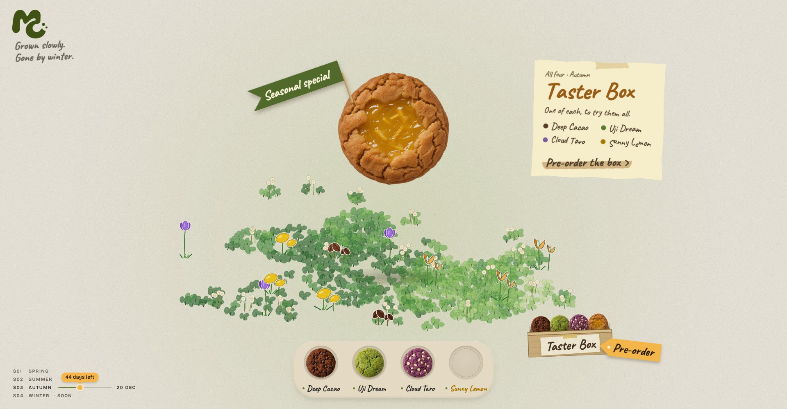

# Moss & Crumb

A design concept for a seasonal cookie homepage. Moss & Crumb is a fictional brand, not a real shop.



## The idea

A cookie shop's homepage that changes with the season, like a seasonal menu. Instead of a product grid, it's one small scene you play with: tap the cookie, it crumbles, and a plant grows from its flavour.

This version is Autumn 2026, with four flavours: Deep Cacao, Uji Dream, Cloud Taro and Sunny Lemon.

## How it works

- **Tap the cookie** to grow a plant. **Pick a flavour** from the tray to try another.
- A **handwritten note** shows the flavour's name, a short description and taste notes (rated in dots).
- **Try all four** and a Taster Box appears, with a Pre-order tag.
- The **timeline** at the bottom left shows how much of the season is left.

## Design decisions

- **Learn by touch, not text.** Each flavour is discovered by playing with it.
- **Say things once.** The deadline appears in one place only: the progress line at the bottom left.
- **Hints, not labels.** There is no "tap me". The cookie hops now and then, and untried cookies bob in the tray.
- **Colour with a job.** The flavour's colour marks its name and dots; everything else stays a quiet brown.

## Run it

A single static file, no build step. From the repo root:

```bash
python3 -m http.server 5174
```

Open <http://127.0.0.1:5174/prototype/season.html>

For laptop and desktop screens. Pre-order is a stand-in; nothing is for sale.

## In this repo

- `prototype/season.html`: the concept
- `prototype/moss.html`: the earlier version it grew out of
- `src/`, `public/`: an earlier Next.js experiment and the cookie images
